# ALTTP-DX

*The Legend of Zelda: A Link to the Past*, rebuilt to run natively on PC,
with the extras a modern re-release would have.

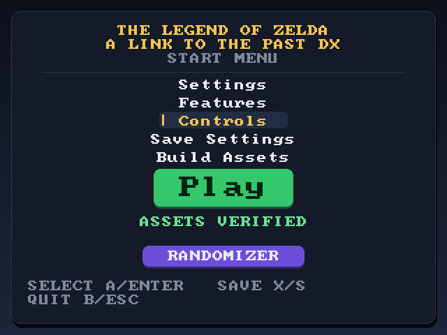

- **CRT filters:** seven looks, from clean scanlines to an arcade monitor to
  a composite signal falling apart on a cheap TV, run as real GPU shaders,
  with curvature, a TV bezel, afterglow and HDR
- **Updates itself:** the start menu offers each new version and installs it
  when you say so
- **Widescreen**, with a camera that keeps the whole wide picture in the area
  you're in and a HUD that moves out to the edges
- **Dynamic lighting:** flickering torches that really light the room, soft
  shadows, glowing lava, lightning and magic, plus embers, sparks, leaves,
  splashes and mist
- **Rumble** for hits, explosions, bosses, the hammer and more
- **MSU-1** music packs, including deluxe packs, with tracks as `.pcm`, FLAC,
  Ogg Vorbis or `.opuz`
- **Settings everywhere:** a start menu before the game, and the same settings
  inside it, each with a description
- **Achievements:** 49 of them, from the story to the secrets to a few
  challenges, with a banner when one unlocks
- **Quality of life:** item switching with L and R, a second item on X, Save
  and Continue, and optional gameplay tweaks and bug fixes
- **Randomizer:** play [alttpr.com](https://alttpr.com) seeds with an item
  tracker that auto updates. 
- **Modding and languages:** the tools are built in, under **Tools** on the
  start menu

You bring your own US ROM. No game data ships here, and once the assets are
built the ROM isn't needed again.

## Download

[Releases](https://github.com/YeOldPress/alttp-dx/releases) have the game for
each platform, with everything it needs inside, the tools included:

| | Download |
| --- | --- |
| macOS 11+, Apple Silicon | `alttp-dx-*-macos-arm64.zip` |
| Linux x86_64, glibc 2.35+ | `alttp-dx-*-x86_64.AppImage` |
| Windows x86_64 | `alttp-dx-*-windows-x86_64.zip` |

Up to v1.8 the tools were a download of their own, `zelda3-tools`; from v1.9
they're in the game, and that one can go. The **Nightly** release is the latest work
in progress, rebuilt overnight whenever something's changed; the numbered
releases are the ones to play.

The Mac app isn't notarized, so the first time, run
`xattr -dr com.apple.quarantine /Applications/ALTTP-DX.app` or allow it under
System Settings → Privacy & Security. On Linux, `chmod +x` the AppImage first.
On Windows, SmartScreen asks once: "More info", then "Run anyway". Put the
game somewhere you can write to, so it can update itself.

### Updates

From v1.8 on, you download the game by hand once. When the start menu opens,
it asks GitHub in the background whether there's a newer version, and if
there is, an **Update** button shows up under the title. Nothing downloads
until you press it. The game checks the download against the size and SHA-256
GitHub publishes, puts it in place and restarts:

- **Mac:** the whole `ALTTP-DX.app` is swapped for the new one. A file the
  game downloads itself isn't quarantined, so `xattr` is a one-time thing.
- **Linux:** the AppImage is replaced in place, under the same name, so your
  shortcuts keep working.
- **Windows:** the files beside `zelda3.exe` are replaced, except your
  `zelda3.ini`.

Your saves and settings carry over. Under **General**, **Check For Updates**
turns this off, and **Update Channel** picks **Releases** or **Nightly**. The
start menu's bottom-right corner says which version you're on, and a build
you made yourself never offers to update. From a terminal, `--version` prints the version,
`--check-update releases` asks without changing anything, and
`--update releases` (or `nightly`) does the whole thing.

## Playing

Start the game, give it your ROM when it asks (drag the `.sfc` onto the
window), and press **Play**. It builds its assets from the ROM once and checks
them every time after that.

| Button | Key | | Key | Action |
| --- | --- | --- | --- | --- |
| D-pad | Arrows | | Alt+Enter | Fullscreen |
| Start | Enter | | P | Pause |
| Select | Right Shift | | Ctrl+Up/Down | Window size |
| A | X | | Shift+= / Shift+- | Volume |
| B | Z | | | |
| X | S | | | |
| Y | A | | | |
| L / R | C / V | | | |

Everything can be rebound, from **Controls** in the start menu or in the game.

The Mac app and the AppImage keep `zelda3.ini`, the assets and your saves in
`~/Library/Application Support/alttp-dx` or `~/.local/share/alttp-dx`. On
Windows everything stays in the game's folder. If you played it back when it
was called alttp-zig, your old folder moves over by itself on the first start.

## Lighting and particles

Dark rooms are lit for real: torches, braziers and sconces flicker and light
the room around them, walls cast soft shadows, and anything that burns,
sparks or glows lights up its surroundings, from fire rod shots to Turtle
Rock's lava to Agahnim's lightning. Rooms that aren't dark dim a little when
they have a fire for it to light, and rooms without one are left as the
original draws them. Embers rise off fire, the sword sparks off walls, cut
bushes shed leaves, waterfalls throw up mist, the air shimmers over lava and
the desert sand, bombs send shockwaves rippling out, fireflies blink in the
Lost Woods, dust drifts in the light from windows, magic and crystals bloom,
and the opening night gets a proper storm. Water, out in the world and down in the dungeons, is
redrawn at the screen's own resolution, with drifting light, fine wisps, foam
along the shore, and Link reflected in it. Turtle Rock's lava is too, molten and
churning under a cooling crust.

<table>
  <tr>
    <td>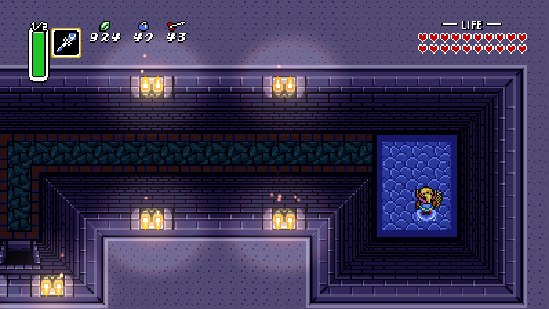</td>
    <td>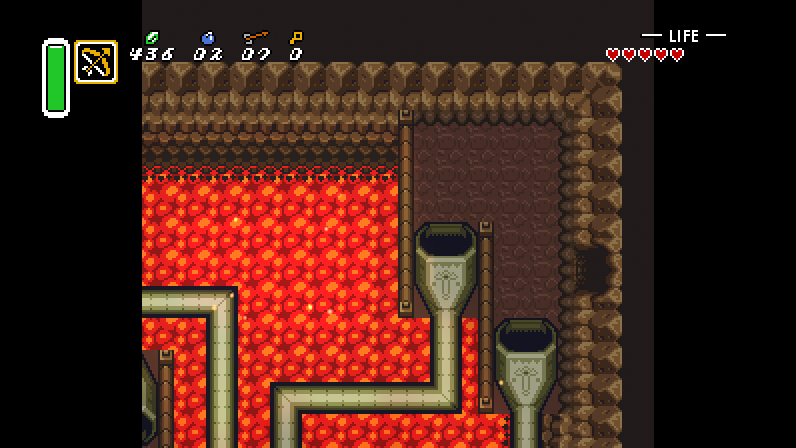</td>
  </tr>
  <tr>
    <td>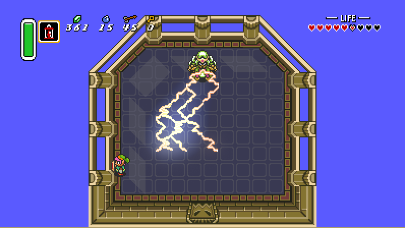</td>
    <td>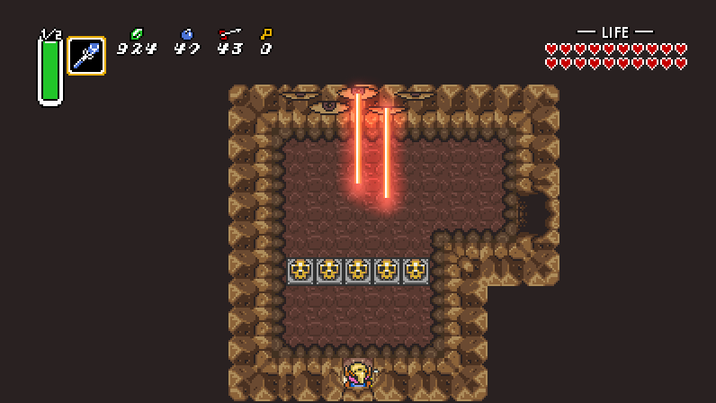</td>
  </tr>
</table>

It's all drawing; the game plays the same with it on or off. **Dynamic
Lighting**, **Lighting Quality** (Full, or Simple for slower graphics cards),
**Room Dimming**, **Particles** and **HD Water/Lava** are under Graphics in
Settings. Shadows, glow and HD Water/Lava need a GPU.

## Settings

**The start menu** opens before the game: Settings, Features, Controls,
building the assets, and Play. Press Y or I on any setting to see what it
does. Turn the menu off with **Start Menu** in Settings.

**In the game**, press Select. The menu slides down with Continue, Save and
Continue, and Save and Quit, and the settings on the pages after it, L and R
to move between them. Select again puts it away. The player select screen has
the settings too.

<table>
  <tr>
    <td>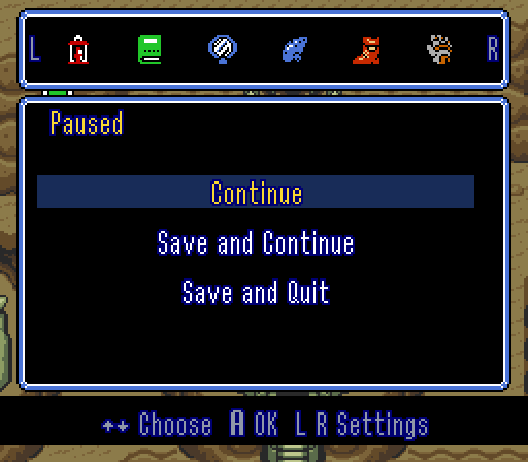</td>
    <td>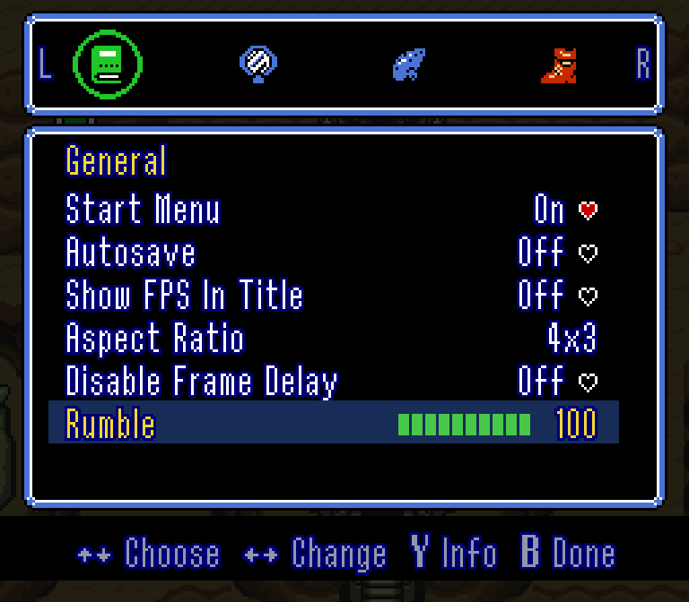</td>
  </tr>
  <tr>
    <td>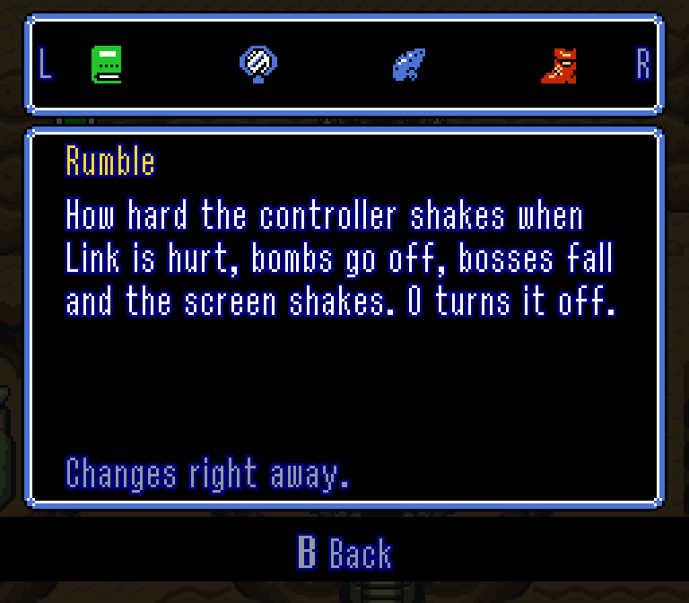</td>
    <td>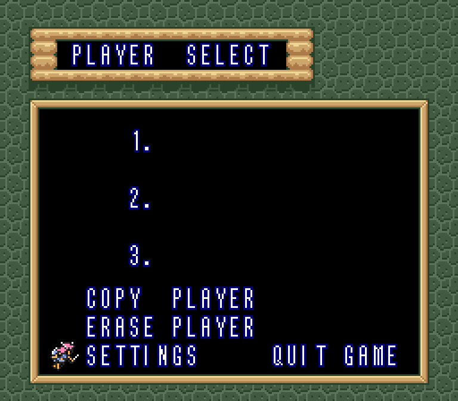</td>
  </tr>
</table>

Most settings take effect straight away. The ones that can't say so.

### CRT filters

**CRT Filter**, under Graphics, draws the picture like an old screen. With
SDL's GPU renderer (Metal on a Mac, Vulkan on Windows and Linux) the looks run
as real shaders.

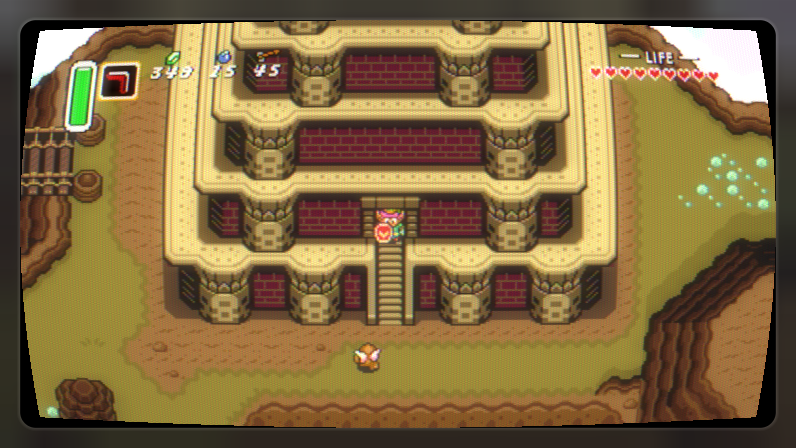

Up close, at the size they're drawn:

<table>
  <tr>
    <td>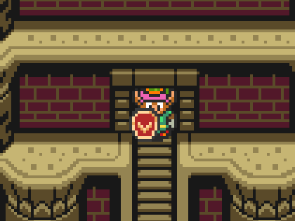<br><b>Off</b>: plain pixels</td>
    <td>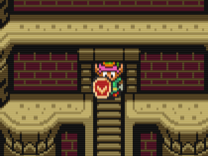<br><b>Scanlines</b>: scanlines alone, the beams fattening on bright colors and thinning in the dark</td>
  </tr>
  <tr>
    <td>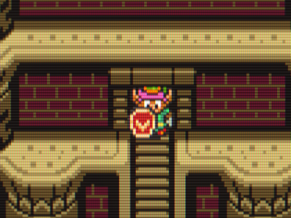<br><b>Arcade</b>: hard lines and a strong grille, like an arcade monitor up close</td>
    <td>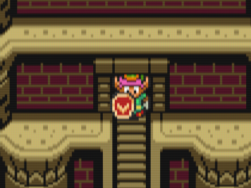<br><b>Soft</b>: gentle lines and a faint shadow mask</td>
  </tr>
  <tr>
    <td>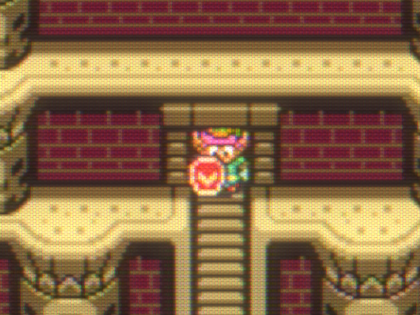<br><b>Consumer TV</b>: a home TV: soft lines, a slot mask, a glow, a little smear and darker corners, curved and framed</td>
    <td>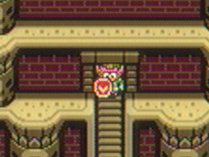<br><b>Composite</b>: a real NTSC signal taken apart by a cheap TV: rainbows on dithering, dot crawl, color bleeding, halos and a ghost from the cable</td>
  </tr>
  <tr>
    <td>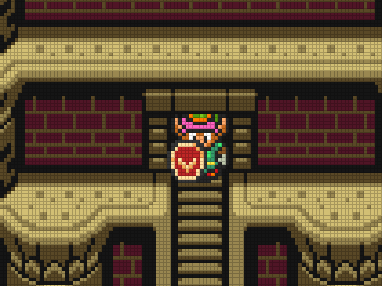<br><b>LCD</b>: a handheld's screen: a fine grid between the pixels, no lines</td>
    <td></td>
  </tr>
</table>

**CRT Scanlines**, **CRT Mask**, **CRT Glow** and **CRT Afterglow** turn each
part up or down, from 0 to 200% of the look as it comes. **CRT Curvature**
bows the picture like a tube, **TV Bezel** puts it in a frame whose plastic
catches the light from the screen, and **HDR** lets it shine past white on a
display that has it. Picking a look loads its own defaults, and **Reset CRT
Settings** puts them back. Randomizer seeds get the filters on the game, but
not on the tracker. Without a GPU renderer, each look falls back to a simpler
version of itself.

**Pixel Scaling** decides how the pixels are blown up to the window:
**Sharp** (even, square pixels at any size, with soft edges), **Nearest**
(crispest, but uneven at most sizes), **Smooth** (blurred) or **xBR**
(diagonals and curves rounded off, flat areas crisp).

### Achievements

There are 49 achievements: the story, collecting things, the side quests and
secrets, and a few challenges, such as beating a boss without being hit. Each
one unlocks with a banner at the top of the screen. The list is in the start
menu and on the last page of the Select menu, with what each one asks for.

They count across all three save files and are kept in
`saves/achievements.txt`. Loading a save that's already far along unlocks
everything it has done. Cheats pause them until you're back at the title or
the file select, and randomizer seeds don't count.

### MSU-1

Turn on **MSU Audio** under Sound (`EnableMSU = true`), and track `n` plays
from `<MSUPath><n>`, as `.pcm`, `.flac`, `.ogg` or `.opuz`: the first of those
there, whichever kind it is. Mono and stereo output both work, at any
**Audio Frequency**.

Deluxe packs have a track for each area and doorway rather than each song. A
pack says it's one in a `pack.ini` beside its tracks (`Deluxe = 1`), which an
import sets when the pack has deluxe-only tracks and the tools' MSU-1 page
switches either way. Where a deluxe pack leaves an area out, its ordinary
track for that song plays. Older inis that said `deluxe`, `opuz` or
`deluxe-opuz` are turned into `true` (and a `pack.ini`) when the game starts.

FLAC sounds exactly like the `.pcm` in about half
the space; Ogg Vorbis takes about an eighth, and you won't hear the difference
either. They can be any sample rate (the game matches them to its own) and
keep their loop point as a `LOOPSTART` tag, in samples at the track's own
rate, the way game music rips usually do. To make your own from a
`.pcm`, skip its 8-byte header, which holds the loop point:

```sh
tail -c +9 track-1.pcm > track-1.raw
oggenc -r -q 5 -c LOOPSTART=123456 -o track-1.ogg track-1.raw
```

MP3 isn't supported: it pads every file with a little silence, which would
click at each loop.

With MSU on, **Import MSU-1** in the start menu installs a pack for you: drop
its folder or `.zip` on the window, or browse for it. It finds the tracks
whatever the pack calls them, asks what to call the pack (its folder or zip's
name to start with), and copies it into a folder of its own, `msu/<name>/`, so
you can keep as many soundtracks as you like. A bar shows how far it's got,
and B or Esc stops it without touching the packs you have.
The one just imported is the one that plays; **MSU Pack** under Sound switches
between them. Importing a pack again replaces only that pack. A pack of `.pcm`
tracks can go in as FLAC, ticked unless you untick it as you name it. Each
track is decoded again and checked against the original, sample for sample,
before the `.pcm` is let go of. **Shrink to FLAC**
on the tools' MSU-1 page does the same to every pack you've already installed.

The tools' MSU-1 page lists every installed pack, with its tracks, what kind
they are and how much room they take, and marks the one that plays. **Use**
picks another, **Show** opens its folder, **Rename** changes its name (and
`MSUPath` with it, if it's the one playing), and **Delete** asks first. A pack
installed by an older version, loose in `msu/` itself, is moved into
`msu/Earlier import/` the first time the game starts, and `MSUPath` follows.

## Randomizer

Generate a seed on [alttpr.com](https://alttpr.com) from the Japanese 1.0 ROM,
press **Randomizer** in the start menu, and drag the seed onto the window.
Seeds play in a built-in SNES emulator, exactly as the randomizer made them,
with an item tracker beside the game, over it, or in its own window.

[The randomizer guide](docs/randomizer.md) has the rest: the seed page, MSU-1
for seeds, the tracker and its options.

## Tools

Everything to do with the assets besides playing: building them, exporting the
maps, text, graphics and music to edit, building them back (by itself, each
time you save a change, if you like), then playing to try it. They show the
exported pictures and check `.zspr` Link sprites, play the game's music, look
over MSU-1 packs before you import them, and add languages from translated
ROMs. **Tools** on the start menu opens their window, which a mouse, the keys
or a pad all drive; **Start Menu** in its corner goes back, and **Play** goes
straight into the game. From a terminal, `zelda3 tools` opens the window too,
and a command does the job without one:

<table>
  <tr>
    <td>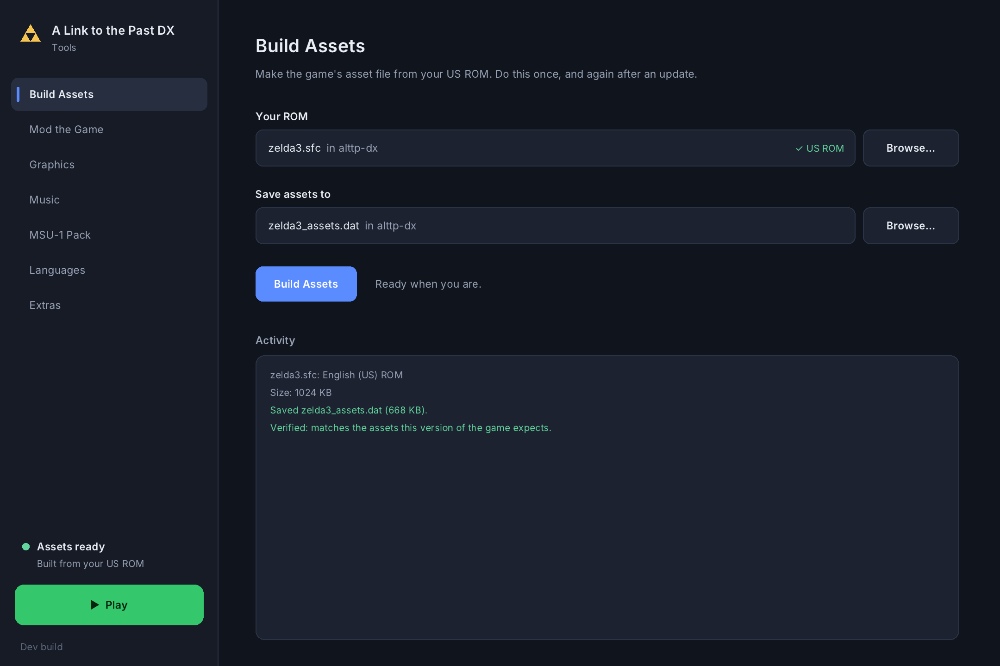</td>
    <td>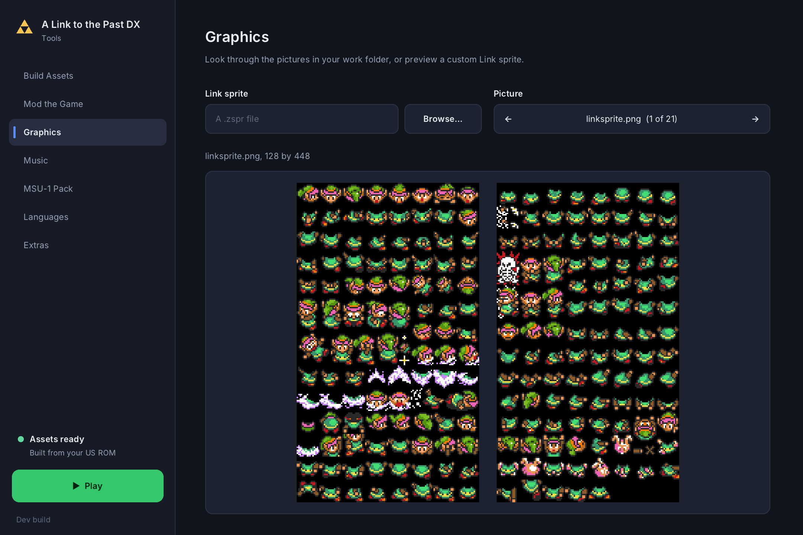</td>
  </tr>
</table>

```sh
zelda3 tools export --rom zelda3.sfc --out my_mod
zelda3 tools build --from my_mod
zelda3 tools extract-dialogue --rom german.sfc --out langs
zelda3 tools build --languages de,fr --lang-dir langs
zelda3 tools check-msu my_pack.zip
zelda3 tools shrink-msu
zelda3 tools help
```

On a Mac, `zelda3` is `ALTTP-DX.app/Contents/MacOS/zelda3`; on Linux, the
AppImage takes the same commands.

Set `Language = de` (or whichever) in `zelda3.ini` to play in a language you've
added. Only the US ROM builds the asset file; its SHA-256 is
`66871d66be19ad2c34c927d6b14cd8eb6fc3181965b6e517cb361f7316009cfb`.

## Building

ALTTP-DX is written in [Zig](https://ziglang.org). You need Zig 0.17.0 and
SDL3:

```sh
sudo apt install libsdl3-dev   # Ubuntu 25.10 or newer
sudo dnf install SDL3-devel    # Fedora
sudo pacman -S sdl3            # Arch
brew install sdl3              # macOS

git clone https://github.com/YeOldPress/alttp-dx
cd alttp-dx
zig build run                      # build and start the game
zig build tools                    # build and open the tools window
zig build assets                   # build the asset file, no window
zig build test                     # the tests
zig build -Doptimize=ReleaseSafe   # a faster build
```

On Windows, take `SDL3-devel-<version>-mingw.zip` from
[SDL's releases](https://github.com/libsdl-org/SDL/releases), build with
`-Dsdl-include=<sdl>\x86_64-w64-mingw32\include -Dsdl-lib=<sdl>\x86_64-w64-mingw32\bin`,
and copy `SDL3.dll` next to the binaries. The same flags with
`-Dtarget=x86_64-windows` cross-compile from Linux or macOS.

[The command-line notes](docs/command-line.md) cover the debug keys, rendering
frames without a window, and checking the game against the original.

## Where it comes from

ALTTP-DX began as a fork of [snesrev/zelda3](https://github.com/snesrev/zelda3),
the reverse-engineered reimplementation of the whole game, and it can still be
run frame for frame against the original machine code to prove it plays the
same. Upstream's Discord:
https://discord.gg/AJJbJAzNNJ

## Credits

- **snesrev**, who reverse engineered the game and wrote the reimplementation
  this grew out of, and the upstream contributors: FitzRoyX, Keaton Greve,
  xander-haj, Patrick Mollohan, DaBanana64, Jason Shearer, KiritoDev, Nutzzz,
  UltraHDR, DPS2004, David Girón, Goodlyay, Jarrod Makin, Rémy F, Stefan
  Sperling, Thomas, Timár Csaba, VictorXPDE, hgdagon, liffy, makolyte and
  vanfanel.
- **spannerism**, for the Zelda 3 JP disassembly, and the authors of the other
  disassemblies that named the game's functions and variables.
- **elzo_d**, for [LakeSnes](https://github.com/elzo-d/LakeSnes): the PPU and
  DSP upstream optimized, and the rest of the console that plays randomizer
  seeds.
- The [ALttP Randomizer](https://alttpr.com) team: **sporchia** and the
  [generator](https://github.com/sporchia/alttp_vt_randomizer), whose code says
  where a seed keeps its settings, and **KatDevsGames** and the
  [z3randomizer](https://github.com/KatDevsGames/z3randomizer) contributors,
  whose code says where it keeps what you've found and how its MSU-1 tracks
  work.
- **kattothepast** and the [alttptracker](https://github.com/kattothepast/alttptracker)
  contributors, for which save data flag is which check and where each one
  sits on the map.
- The fan translators behind the
  [Spanish](https://www.romhacking.net/translations/2195/),
  [Polish](https://www.romhacking.net/translations/5760/),
  [Portuguese](https://www.romhacking.net/translations/6530/),
  [Dutch](https://www.romhacking.net/translations/1124/),
  [Swedish](https://www.romhacking.net/translations/982/) and English Redux
  ([1](https://www.romhacking.net/translations/6657/),
  [2](https://www.romhacking.net/hacks/2594/)) versions the tools can read.
- [SDL](https://libsdl.org), and [Opus](https://opus-codec.org) by the
  Xiph.Org Foundation.
- Nintendo, for the game.

## License

MIT, see `LICENSE.txt`, which keeps the original notices: Copyright (c) 2022
snesrev and Copyright (c) 2021 elzo_d.

Vendored in `third_party/`: Opus 1.3.1 (3-clause BSD, `COPYING` there and in
`LICENSE.txt`), dr_flac (public domain or MIT-0) and stb_vorbis and
stb_truetype (public domain or MIT). SDL3 is a system dependency.

No game assets are distributed here.
